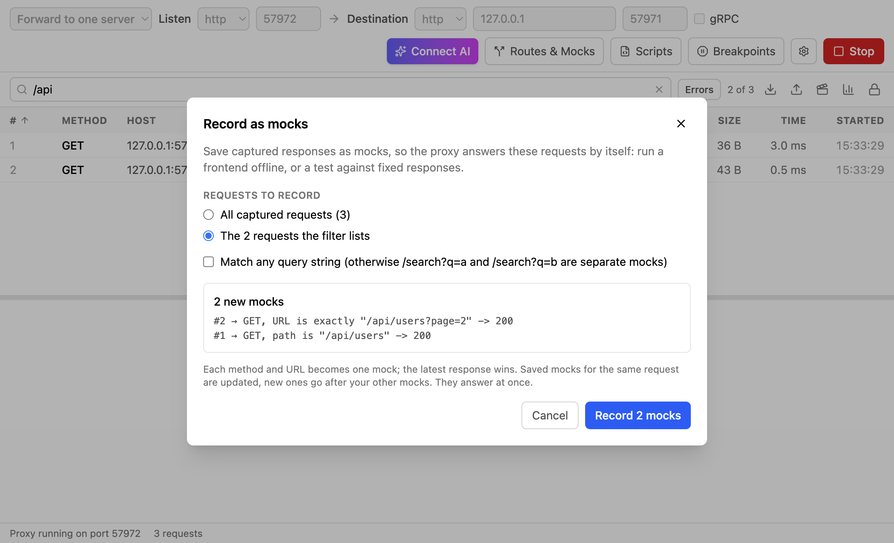

# Reversee

**[reversee website &amp; docs →](https://galusben.github.io/reversee/)** · Open source (MIT) · [Releases](https://github.com/galusben/reversee/releases/latest)

A reverse-proxy web debugger: see, intercept, and edit HTTP/HTTPS traffic between a client and a server with the least setup possible.

Reversee sits between your client and a destination server. Point your client at Reversee's listen port and every request and response shows up in the traffic table — headers, bodies (with gzip/brotli decoding and syntax highlighting), timings, and a copy-as-curl command.

## Features

- **HTTP and HTTPS** on both sides — listen on either protocol, forward to either protocol. HTTPS listening uses a locally generated root CA you can trust once (macOS: _Proxy Settings → Manage Root Cert_).
- **Tabs: debug several tools at once** — each tab is its own proxy with its own listen port, destination, mocks, scripts, breakpoints and traffic, and every tab keeps running in the background. A tab that holds a request at a breakpoint is flagged so a blocked client never goes unnoticed. ⌘T opens a tab, ⌘1…9 switches. See [Tabs](#tabs).
- **Capture anything** — switch from "Forward to one server" to "Capture anything" and Reversee becomes a regular HTTP/HTTPS proxy: set `HTTP_PROXY` / `HTTPS_PROXY` to its address and every request a program makes is captured, whichever server it goes to. HTTPS is decrypted with certificates signed by the Reversee root CA. See [Capture anything](#capture-anything).
- **Traffic inspection** — a sortable table (method, host, path, status, content type, size, duration) with headers, request/response bodies (plain and formatted), and a per-request timing waterfall (DNS, TCP, TLS, first byte, download). Requests show up while they are still in flight.
- **Streaming and WebSockets** — responses are streamed through, so Server-Sent Events and large downloads work as they would without the proxy. WebSocket connections are tunnelled and their messages listed.
- **Scripts (interceptors)** — JavaScript snippets that rewrite requests (`requestParams`: host, path, method, port, headers, body) or responses (`responseParams`: statusCode, headers, body) on the fly. The Scripts screen has one-click examples and a **Try it** button that shows what a script changes on a captured request before you turn it on; saving applies it to the running proxy without a restart. Errors and `console.log` output are shown on the request.
- **Breakpoints** — hold requests, or responses, matching a URL regex + methods, edit them, then continue.
- **Mocks and routes** — answer any request with a response you write (fake an endpoint, force a 500, add latency), or send some requests to a different upstream by path or Host. No code, plain "path starts with" matching, one click from a captured request, and changes apply while the proxy runs.
- **Record and replay** — one click turns the captured session (or just the requests the filter lists) into mocks, so a frontend can run offline or a test can run against fixed responses. See [Record and replay](#record-and-replay).
- **Replay and HAR** — re-send a captured request (as is, or edited), and export or import sessions as HAR files.
- **Compare two requests** — right-click a request, _Mark for Compare_, then right-click another and _Compare with #N_: a side-by-side diff of the status, request line, headers and bodies (JSON pretty-printed with sorted keys, compressed bodies decoded) that answers "why did this call work and that one fail".
- **gRPC** — proxy native gRPC over HTTP/2 (h2 via ALPN, or cleartext h2c) and decode every message — unary and server/client/bidi streaming — into readable JSON, using `.proto`/`.desc` definitions you import. See [gRPC](#grpc).
- **Redirect & host rewriting** — keep redirect chains and Host headers pointed at the proxy.
- **Upstream TLS options** — a client certificate for mutual TLS, optional certificate verification, and a response timeout.
- **Light and dark themes**, keyboard navigation, and a configurable history size.
- **MCP integration** — let Claude Code, Cursor, or any MCP client inspect and (optionally) control the proxy. See below.

## Tabs

Debugging a mobile app against one API and a CLI against another? Open a tab per tool (**+** in the tab strip, or ⌘T / Ctrl+T). Each tab is an independent proxy:

- its own **listen port and destination** (or capture-anything mode), **routes and mocks**, **scripts**, **breakpoints** and **captured traffic**;
- its own worker process, so a script that hangs in one tab never stalls the others;
- shared across tabs: the root certificate, proto specs, theme, history size and the MCP switches.

All tabs keep proxying while you look at another one. The strip shows each tab's state (● running, ○ stopped, red on error), its port and request count, a blue dot for traffic you have not looked at, and an amber ⏸ with a count when the tab is **holding requests at a breakpoint**. A notice offers to take you there, because a held request blocks a real client.

A new tab opens stopped on the next free port. Tabs are named after their destination (`api.example.com`; a second tab on the same host becomes `api.example.com #2`). Double-click a tab to rename it. Names are unique, so you and an agent can refer to a tab by name. Starting a tab on a port another tab is using says which tab that is. Tabs and their settings are restored when Reversee starts, stopped as before. Shortcuts: ⌘T new, ⌘⇧D duplicate, ⌘W close (⌘⇧W closes the window), ⌘1…⌘9 and ⌃Tab / ⌃⇧Tab to switch; use Ctrl instead of ⌘ on Windows and Linux.

Agents see tabs too: `list_tabs` lists them, and every tab-scoped tool takes an optional `tab` (an id like `t2`, or a name) that defaults to the tab on screen. With control enabled, an agent can open a tab of its own with `create_tab`, so it can debug something without touching yours.

## Capture anything

In the default mode Reversee stands in front of one destination. In **Capture anything** mode it is a normal HTTP proxy, so you do not have to change the URLs your program calls:

1. Pick **Capture anything** in the mode selector, choose a port, and press **Start**.
2. Point the program at the proxy:

   ```sh
   export HTTP_PROXY=http://127.0.0.1:8000 http_proxy=http://127.0.0.1:8000
   export HTTPS_PROXY=http://127.0.0.1:8000 https_proxy=http://127.0.0.1:8000
   ```

3. For HTTPS, make the program trust the Reversee root certificate. Save it with _Proxy Settings → Export Root Cert_, then for example:

   ```sh
   curl -x http://127.0.0.1:8000 --cacert reversee.root.pem https://example.com/
   NODE_EXTRA_CA_CERTS=reversee.root.pem node --use-env-proxy app.js
   REQUESTS_CA_BUNDLE=reversee.root.pem python app.py
   ```

Each request is listed under the host it went to. Mocks, routes, scripts, breakpoints, replay and WebSocket capture all work in this mode. Good to know:

- A client that does not trust the certificate shows up as a failed `CONNECT` row. Apps that pin their server's certificate cannot be inspected.
- Clients are offered HTTP/1.1 inside the tunnel, so gRPC decoding is only available in the one-server mode.
- The servers' certificates are verified by default in this mode (Preferences has a switch for self-signed servers).
- In this mode the proxy accepts connections from this machine only.
- Only trust the root certificate on machines you control. Anyone holding its key can read that machine's HTTPS traffic.

## Record and replay

Capture a session through the proxy, then click **Record as mocks** in the traffic toolbar (or right-click a request → _Record as Mocks…_). Pick all captured requests, the ones the filter lists, or the single request, and Reversee saves each response as a mock rule. From then on the proxy answers those requests itself, with the upstream switched off if you like: run a frontend offline, or point a test at fixed responses.



- **One mock per method and URL.** When a URL was captured more than once, the latest response wins.
- **Query strings.** A recorded `/search?q=a` answers only that exact URL, and is placed before any path-only mock. Tick _Match any query string_ to record one mock per path instead.
- **Faithful responses.** The status, headers and body are kept. Hop-by-hop headers, `content-length` and `date` are dropped, and `content-encoding` too, since the stored body is the decompressed one. Binary bodies (images, protobuf) are stored as base64 and served byte for byte. When several `Set-Cookie` headers were sent, only the first is kept.
- **What is skipped, and why.** Requests still in flight, failed ones, responses that were already mocks, WebSockets, gRPC, `304 Not Modified`, truncated bodies and bodies over 512 KB (8 MB per recording) are left out; the dialog says which and why before you save.
- **Ordinary mocks.** Recordings are named `Recorded: GET /path` and show up in _Routes & Mocks_, where you can edit, reorder or switch them off. Recording the same request again updates its mock in place; new mocks go after your own, so hand-written mocks keep priority.

Agents can do the same with the [`record_mocks`](docs/mcp-tools.md#record_mocks-) MCP tool, and a HAR file you import can be recorded like captured traffic.

## Install

**macOS (Homebrew):**

```sh
brew tap galusben/reversee
brew install --cask reversee
```

If Homebrew reports the tap is untrusted, run `brew trust galusben/reversee` once and re-run the install.

**macOS / Linux (one-liner):**

```sh
curl -fsSL https://raw.githubusercontent.com/galusben/reversee/main/install.sh | bash
```

**Windows / manual:** download the installer for your OS from [Releases](https://github.com/galusben/reversee/releases).

macOS builds are signed and notarized; the app updates itself from GitHub Releases.

## Getting started

1. Install and launch Reversee.
2. Pick a listen protocol and port (ports below 1024 need admin/root).
3. Pick the destination protocol, host, and port.
4. Click **Start**.

Test it:

```sh
curl http://localhost:<listen-port>/
```

The request appears in the traffic table; click it to inspect.

## HTTPS and the root certificate

Listening on `https` uses a certificate signed by a root CA that Reversee generates on first run. Trust it once (macOS: _Proxy Settings → Manage Root Cert_; elsewhere export it with _Export Root Cert_ and add it to your client or system store). The listener certificate covers `localhost`, `127.0.0.1` and `::1`.

- New roots are valid for ten years. Reversee warns when the root is within 30 days of expiring, and _Proxy Settings → Regenerate Root Cert…_ (or _Preferences_) replaces it. A regenerated root has to be trusted again.
- In packaged builds the root's private key is encrypted with the operating system keychain rather than stored in plain text. If the key cannot be unlocked, Reversee keeps the saved root untouched and runs on a temporary one for that session. Profiles selected with `REVERSEE_USER_DATA` (tests, throwaway agent instances) never use the keychain.

## gRPC

Reversee proxies native gRPC and decodes the protobuf messages — wire bytes carry only field numbers, so it decodes them against definitions you supply.

1. Check **gRPC** in the settings bar. This runs an HTTP/2 listener: with an `https` listen protocol it negotiates h2 via ALPN; with `http` it speaks cleartext h2c (prior knowledge). Point your gRPC client at the listen port.
2. Open **gRPC → Proto Specs** and import a `.proto` file or a compiled `.desc` FileDescriptorSet (no `protoc` needed for `.proto` — Reversee parses it directly). Specs are saved across restarts and matched to calls by method (`/package.Service/Method`); compile errors surface in the dialog.
3. Each call shows in the traffic table with a **gRPC** badge and its `grpc-status`. The detail pane's **gRPC** tab renders every request/response message as JSON (all four call types — unary and server/client/bidi streaming — with each streamed message listed), alongside the raw bytes.
4. Agents can manage specs over MCP with `list_proto_specs` / `add_proto_spec` / `remove_proto_spec`, and `get_traffic_entry` returns the decoded messages and status.

With gRPC enabled the port serves both protocols: gRPC over HTTP/2 and ordinary HTTP/1.1 clients. Interceptors, breakpoints and mocks apply to the HTTP/1.1 requests; HTTP/2 streams are passed through unchanged.

## MCP integration (Claude Code / Cursor)

Reversee ships an MCP server so LLM agents can drive it. With the Reversee app running:

**Claude Code** — one line:

```sh
claude mcp add reversee -- npx -y reversee-mcp
```

**Cursor** — add to `~/.cursor/mcp.json`:

```json
{
  "mcpServers": {
    "reversee": { "command": "npx", "args": ["-y", "reversee-mcp"] }
  }
}
```

The package is published as [`reversee-mcp`](https://www.npmjs.com/package/reversee-mcp). When developing against a checkout, use the local build instead: `npm run build:mcp`, then `claude mcp add reversee -- node /path/to/reversee/mcp/dist/cli.js`.

### Tools

| Tool                                                        | Description                                                                                                                   |
| ----------------------------------------------------------- | ----------------------------------------------------------------------------------------------------------------------------- |
| `list_tabs`                                                 | The open tabs (each its own proxy): id, unique name, port, destination, running state, request and held counts                |
| `create_tab` / `rename_tab` / `close_tab`                   | Open a background tab for the agent's own work, rename one, or close one                                                      |
| `get_status`                                                | App version, proxy state, listen/destination config, traffic count                                                            |
| `get_config` / `update_config`                              | Read / change the proxy configuration                                                                                         |
| `start_proxy` / `stop_proxy` / `restart_proxy`              | Control the proxy process                                                                                                     |
| `list_traffic`                                              | Captured requests (newest last), bodies elided                                                                                |
| `search_traffic`                                            | Filter requests server-side (method, status, URL/regex, content-type, header, body, timing, errors) — fetch only what matters |
| `summarize_session`                                         | Aggregate view: status classes, methods, content types, top hosts, errors, slowest                                            |
| `get_traffic_entry`                                         | One request in full: headers, bodies, timings, curl, upstream target, decoded JWTs, and decoded gRPC                          |
| `compare_requests`                                          | Diff two captured exchanges: status, request line, headers and bodies (JSON normalized), with a plain-language summary        |
| `replay_request`                                            | Re-send a captured request with optional edits (method/url/headers/body) to test a hypothesis                                 |
| `set_interceptor`                                           | Install request/response interceptor JS for mocking or fault injection (applies live)                                         |
| `try_interceptor`                                           | Dry-run a script on a captured request: what it changes, errors, console output                                               |
| `decode_jwt`                                                | Decode a JWT's header and claims (inspection only)                                                                            |
| `list_breakpoints` / `set_breakpoints`                      | Read / replace the breakpoint rules (request or response phase)                                                               |
| `list_held_requests` / `resume_held_request`                | See what is held at a breakpoint and resume it, optionally edited                                                             |
| `record_mocks`                                              | Turn captured traffic (all, filtered, or by id) into mocks that serve it again without the upstream                           |
| `export_har`                                                | Write captured traffic (optionally filtered) to a HAR file                                                                    |
| `regenerate_root_cert`                                      | Replace the root CA behind the HTTPS listener (when it has expired)                                                           |
| `list_proto_specs` / `add_proto_spec` / `remove_proto_spec` | Manage protobuf specs used to decode gRPC (add/remove gated)                                                                  |
| `validate_setup`                                            | Setup checks (destination, ports, root cert, proxy process)                                                                   |
| `export_diagnostics`                                        | Versions, platform, settings, state — for bug reports                                                                         |

Tools that act on one tab take an optional `tab` (an id such as `t2`, preferred, or the tab's name) and default to the tab shown in the window. `update_config` takes it inside `patch`. Tools that take a `trafficId` or held-request id find the tab themselves, because those ids are unique across tabs.

`create_tab`, `rename_tab`, `close_tab`, `replay_request`, `record_mocks`, `set_interceptor`, `try_interceptor`, `set_breakpoints`, `resume_held_request`, `export_har`, `regenerate_root_cert`, `update_config`, `add_proto_spec`, `remove_proto_spec`, and the start/stop/restart tools are gated behind _Allow MCP to Control the Proxy_ (or `--allow-mcp-control` headless); the rest are always available read-only.

The app owns this list — it serves the catalog to the bridge at startup, so **tools added in an app update appear automatically** with no MCP-server reinstall (the bridge is a generic passthrough). When the app is not running, the bridge advertises a built-in fallback list and each call returns a "launch Reversee" message.

### Updating the MCP server

You rarely need to — new tools arrive via app updates (the app owns the catalog). If the app does report a newer `reversee-mcp` is recommended (in `get_status`), restart your MCP client; on **npm 11.2+** that pulls the latest automatically.

On **older npm** (including npm 10.x bundled with Node 22 LTS), `npx` caches the server and won't re-fetch a newer version — [a known npm behavior](https://github.com/npm/cli/pull/8100). Clear Reversee's cached copy once, then restart:

```sh
for d in ~/.npm/_npx/*/; do [ -e "$d/node_modules/reversee-mcp" ] && rm -rf "$d"; done
```

This touches only Reversee's `npx` cache; the next run pulls the latest published version.

### Security model

- The bridge talks to the app over a **local socket** (unix domain socket / Windows named pipe), never a TCP port, with a per-boot token — only your user account can reach it.
- It is **read-only by default**. The tools that change state or run code (start/stop/restart, the mock and route tools including `record_mocks`, `update_config`, `replay_request`, `set_interceptor`, `try_interceptor`, `set_breakpoints`, `resume_held_request`, `export_har`, `regenerate_root_cert`, `add_proto_spec`, `remove_proto_spec`) are rejected until you check _Proxy Settings → Allow MCP to Control the Proxy_ in the app.
- _Proxy Settings → Enable MCP Integration_ turns the socket off entirely.

### Headless mode (for agents)

An agent that only needs the proxy can run Reversee without the UI. The Homebrew cask puts `reversee` on `PATH`:

```sh
# isolate the agent's instance with its own profile + socket, allow it to control the proxy
REVERSEE_USER_DATA="$(mktemp -d)" reversee --headless --allow-mcp-control &
```

Then point the MCP client at the same profile (`REVERSEE_USER_DATA`) and drive it. Flags:

- `--headless` — no window/dock; runs on the MCP socket until killed. Implies MCP enabled.
- `--allow-mcp-control` — the launch-time equivalent of _Allow MCP to Control the Proxy_ (start/stop/configure).
- `--no-mcp` / `--allow-mcp` — force the socket off / on.

Flags are session overrides and never change your saved settings. Using a separate `REVERSEE_USER_DATA` lets a headless agent instance coexist with your GUI instance (each gets its own control socket). On Linux a display is still required — wrap with `xvfb-run`.

## Development

Requirements: Node 22+.

```sh
npm install
npm start            # run the app (electron-vite dev, HMR)
npm test             # unit + integration + MCP e2e (vitest)
npm run typecheck    # tsc
npm run lint         # eslint
npm run build && npx playwright test   # app end-to-end tests
npm run dist         # build installers for this platform
```

Layout: `src/main` (Electron main process), `src/preload` (the typed renderer bridge), `src/renderer` (React UI), `src/proxy` (the proxy core — plain Node, runs in a utilityProcess), `src/shared` (types, IPC contracts, settings schema), `mcp/` (the `reversee-mcp` npm package).

New here? The [knowledge base](docs/README.md) is the fast way in: a code map ([docs/architecture.md](docs/architecture.md)), the human + agent feature catalog ([docs/features.md](docs/features.md)), conventions, and architecture decisions. See [CONTRIBUTING.md](CONTRIBUTING.md) to make a change and [AGENTS.md](AGENTS.md) for agent guidance.

Testing is documented in [TESTING.md](TESTING.md) (the four layers and how they map to CI); releases in [RELEASING.md](RELEASING.md).

Releases: push a `v*` tag; CI builds, signs, notarizes, verifies, and publishes macOS/Windows/Linux artifacts, then updates Homebrew. See [RELEASING.md](RELEASING.md).

## License

MIT
